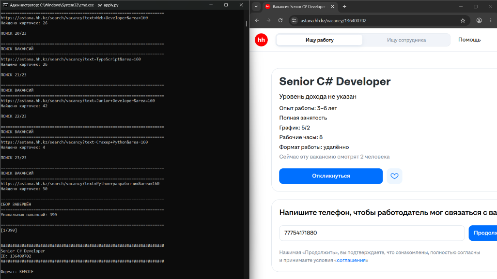
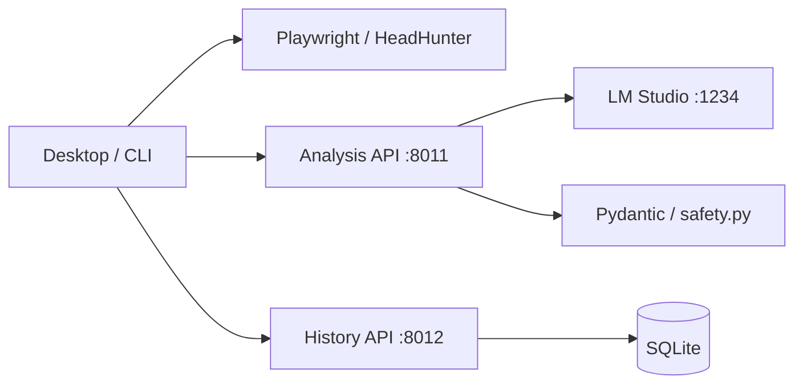

# AI-Hunter

Локальный помощник для поиска вакансий HeadHunter, анализа через LM Studio и отправки откликов под контролем пользователя. Python принимает окончательное решение; LLM предлагает оценку и письмо.



## Архитектура

Монолит разделён на два независимо запускаемых HTTP-сервиса и приложение оператора:



| Компонент | Ответственность |
| --- | --- |
| `services/analysis.py` | API анализа, проверка модели, последовательные запросы к GPU |
| `services/analysis_core.py`, `services/prompts.py` | Промпты, проверка ответа и языка письма |
| `safety.py`, `models.py` | Пороги, опыт, зарплата и блокирующие условия |
| `services/history.py` | Транзакции SQLite, индекс обработанных ID, пагинация |
| `services/client.py` | HTTP-клиент с таймаутами и обработкой отказов |
| `apply.py` | Сбор вакансий, браузер, подтверждение и отправка |
| `desktop.py` | Интерфейс; последние 500 записей загружаются в фоновом потоке |

Сервисы используют общий репозиторий и отдельные процессы. Только history владеет базой. Браузер работает на компьютере пользователя. Поддерживается один оператор на аккаунт/профиль браузера. API предназначены для доверенной локальной машины, не имеют аутентификации и по стандартным командам слушают только loopback.

## Установка и запуск

Требования: Python 3.11+, LM Studio с загруженной моделью, Chromium для Playwright; Desktop использует PySide6. Docker необязателен.

```powershell
git clone https://github.com/Yernaribadulla/AI-Hunter.git
cd AI-Hunter
python -m venv .venv
.venv\Scripts\Activate.ps1
python -m pip install -r requirements.txt
python -m playwright install chromium
python run_services.py
```

Перед поиском включите Local Server в LM Studio. Модель по умолчанию — `qwen/qwen3-4b-2507`; при её отсутствии выбирается первая доступная. OpenAI API key не требуется.

Launcher запускает оба сервиса, ждёт их готовности и открывает Desktop; после выхода останавливает созданные процессы. На Windows доступен `run.bat`. CLI: `python run_services.py --cli`. Только сервисы: `python run_services.py --services-only`, затем в другом терминале `python desktop.py` или `python apply.py`.

Первый запуск создаёт `hh_session/`. Войдите в HH и завершите интерактивные проверки в браузере. Выберите автоматическую отправку или подтверждение каждого отклика. CAPTCHA проходит пользователь.

## Независимый запуск

В отдельных терминалах из корня репозитория:

```powershell
python -m uvicorn services.analysis:app --host 127.0.0.1 --port 8011
python -m uvicorn services.history:app --host 127.0.0.1 --port 8012
python desktop.py
```

Альтернатива: `docker compose up --build -d`, затем `python desktop.py` на хосте. LM Studio должна быть доступна контейнеру через `host.docker.internal:1234`; настройте соответствующий интерфейс прослушивания в LM Studio. SQLite сохраняется в volume `history`. Остановка: `docker compose down`; флаг `-v` удалит историю. Не запускайте Compose и launcher одновременно на тех же портах.

## Настройки

| Переменная окружения | По умолчанию |
| --- | --- |
| `LM_BASE_URL` | `http://localhost:1234/v1`, для analysis |
| `LM_MODEL` | `qwen/qwen3-4b-2507` |
| `JOBHUNTER_ANALYSIS_URL` | `http://127.0.0.1:8011`, для клиента |
| `JOBHUNTER_HISTORY_URL` | `http://127.0.0.1:8012`, для клиента |
| `JOBHUNTER_DB` | `data/history.sqlite3` в корне проекта |

`.env` автоматически не загружается. Пороги и HH настраиваются в `config.py`, опыт и профиль — в `candidate.py`. Замените персональный профиль на свой. Таймаут генерации 300 секунд, клиента analysis — 310 секунд. После изменения конфигурации перезапустите процессы. Launcher использует стандартные порты; для других портов запускайте uvicorn самостоятельно.

## API и перенос истории

OpenAPI: [analysis](http://127.0.0.1:8011/docs), [history](http://127.0.0.1:8012/docs).

| Метод | Путь | Назначение |
| --- | --- | --- |
| GET | `:8011/health` | Жив ли сервис |
| GET | `:8011/ready` | Доступна ли модель |
| POST | `:8011/v1/analyze` | Тело: `{vacancy: {title, description}, instruction}` |
| GET | `:8012/health` | Открыть/проверить базу |
| GET | `:8012/v1/processed` | Заблокированные ID |
| POST | `:8012/v1/records` | Запись `{timestamp, vacancy, result}` |
| GET | `:8012/v1/records?limit=500&before=123` | От новых к старым; before — ID последней записи предыдущей страницы |

При работающем history выполните один раз: `python -m services.migrate results.jsonl`. Исходный файл сохраняется. Повторный импорт добавляет повторные строки, но ID блокировок не дублируются. После сетевого сбоя импорт мог выполниться частично.

Перед потенциальной отправкой сохраняется `submission_pending`. Статусы `applied`, `already_applied`, `rejected_by_ai`, `submission_pending`, `unknown`, `send_error` блокируют повторную обработку. Последующая ошибка формы автоматически не снимает блокировку. Неопределённый результат проверьте вручную в HH; интерфейс снятия блокировки пока не реализован. Ошибка записи истории останавливает дальнейшую работу. Резервируйте SQLite при остановленном history.

Исполняемые скрипты `JobHunter/` перенаправляют запуск на корневую реализацию. Старые вспомогательные модули и пользовательские файлы сохранены; разрабатывайте и запускайте тесты из корня репозитория.

## Проверки

```powershell
python -m pip install -r requirements-dev.txt
python -m unittest discover -s tests -v
python -m compileall -q apply.py desktop.py services run_services.py
```

Тесты не обращаются к HH и LM Studio. Проверяются правила решений, приоритет Python над LLM, язык письма, зарплата с точками, HTTP-контракты, сохранение блокировок, пагинация и отказ от клика при ошибке записи. CI выполняет тесты на Windows/Linux и Python 3.11/3.12.

Проект остаётся персональным инструментом: реальная работа зависит от разметки HH и качества модели. Браузерные сессии, база, резюме и экспорт вакансий содержат персональные данные. Реальную отправку проверяйте под ручным контролем.
