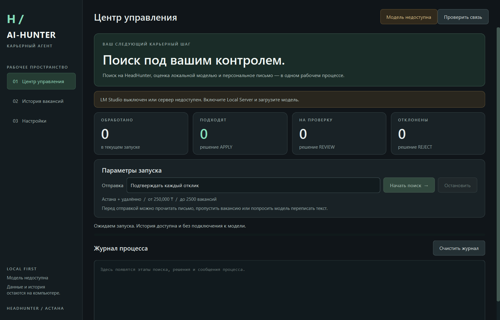

# AI-Hunter

Local-first job discovery, vacancy analysis, and supervised application assistant for HeadHunter.

AI-Hunter combines deterministic vacancy filtering, a local LLM, Pydantic validation, Playwright browser automation, persistent JSONL state, and a confirmation-first application mode. It is designed as a portfolio project and personal job-search tool—not as unattended mass application software.

## Workflow Preview

The native Python desktop opens even while LM Studio is switched off. History and settings remain accessible; the launch button is enabled after the configured model passes a background readiness check.



This screenshot shows the collection stage: multiple search queries are processed through Playwright, vacancies are discovered and deduplicated, and the selected vacancy is opened in a persistent browser session for supervised review.


## Pipeline

```text
Discovery queries → HH collection → normalization/deduplication → local LLM analysis
→ Pydantic validation → deterministic safety decision → letter validation
→ automatic or confirmation-first application → persistent JSONL log
```

The LLM proposes structured analysis; Python owns the final decision. Hard blockers, missing cover letters, language mismatches, salary constraints, duplicate applications, and invalid model output are handled by deterministic checks.

## Main capabilities

- Related-title discovery for Python, backend, AI integration, LLM, API, CRM, automation, and full-stack roles.
- Local analysis through an OpenAI-compatible LM Studio endpoint.
- Structured `VacancyAnalysis` validation with Pydantic.
- Transferable-skill and commercial-experience matching.
- Russian/English cover-letter generation and language validation.
- Duplicate protection through persistent local status records.
- Automatic mode or confirmation-first mode before each final application click.
- Persistent Playwright browser session with user-controlled login and CAPTCHA handling.

## Safety model

The project does not bypass CAPTCHA or anti-bot controls. Browser sessions, cookies, resumes, vacancy history, generated letters, and local model data remain local. Never commit credentials, tokens, cookies, `hh_session`, `results.jsonl`, resumes, or exported vacancy datasets.

The confirmation-first mode shows the generated letter before submission. A successful browser click is not treated as proof that HH recorded the application; uncertain and send-error states require manual verification.

## Local LLM

- Model: `qwen/qwen3-4b-2507`
- Endpoint: `http://localhost:1234/v1/chat/completions`
- Request timeout: 300 seconds

## Requirements

- Windows, Python 3.11+, Requests, Playwright, Pydantic
- PySide6 for the desktop operator interface
- Chromium installed for Playwright
- LM Studio with an OpenAI-compatible local endpoint

## Installation

```powershell
python -m venv .venv
.venv\Scripts\activate
pip install -r requirements.txt
playwright install chromium
```

## Run

Run `python desktop.py` or double-click `run.bat`. No LM Studio connection is needed to inspect the application, history or settings. To start a search, enable the LM Studio local server, load `qwen/qwen3-4b-2507`, then press **Проверить связь**. The app does not start LM Studio or substitute another model.

Choose an application mode and press **Начать поиск**. Confirmation before each application is the desktop default. Automatic submission requires a separate confirmation at launch. The worker opens its persistent Chromium session and the desktop waits for confirmation that you have signed in **in that browser window**. A new installation creates the session directory on first launch. It never treats a login in an unrelated browser as confirmation.

In manual mode a dedicated dialog shows the full cover letter and offers **Отправить отклик**, **Пропустить**, or **Переписать** with an instruction. Closing a review skips the application; cancelling session confirmation aborts the run. Selection of a mode alone never starts a process.

The activity log uses real pipeline events. APPLY counts decisions, not confirmed submissions; the persisted result status distinguishes actual applications from uncertain outcomes. History supports numeric score sorting, persistent filtering across refresh, and a detail dialog with the decision reason and letter. The log is bounded to 2,500 lines.

For the console workflow, run `python apply.py` with LM Studio available. Existing `results.jsonl` and legacy `JobHunter/hh_session` directories are supported.

## Structure

`desktop.py` composes the native PySide6 application. `hunter/ui/` contains views, table models, review dialogs and the QSS theme. `hunter/process.py`, `bridge.py`, `protocol.py`, `health.py` and `history.py` handle the worker lifecycle, loopback requests, incremental event decoding, model readiness and JSONL storage. `hunter/browser.py`, `analysis.py`, `llm.py` and `prompts.py` isolate page operations and model analysis. `apply.py` remains the console entry point and pipeline orchestrator; deterministic decision policy stays in `safety.py`.

See [refactoring decisions and validation](docs/desktop-refactor.md). The historical `JobHunter/` snapshot is retained for compatibility; use the root entry points for the maintained application.

## Testing

```powershell
python -m compileall -q desktop.py apply.py hunter tests
python -m unittest discover -s tests -v
```

The suite uses temporary history files, mocked model requests and harmless subprocess fixtures. It runs without LM Studio, a signed-in HH account or real applications. Native Qt tests use the offscreen platform. Live HH page selectors and actual Qwen generation still require a supervised check with LM Studio running. Stopping force-terminates an unresponsive worker after a short grace period; inspect HH before retrying an application whose final action may already have begun.

## Project status

AI-Hunter V2 is an active portfolio project suitable for local experimentation and supervised applications. It is not a production recruitment platform, does not guarantee correct decisions, and should not be used for unattended mass outreach.
